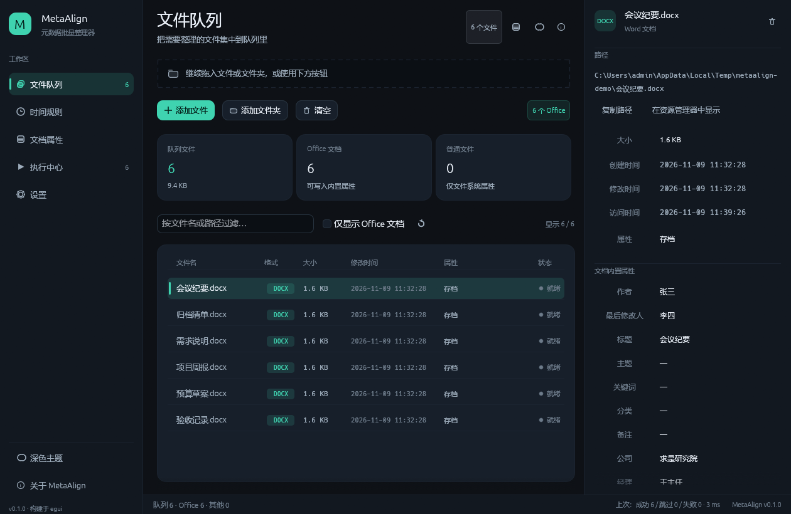

# MetaAlign

**批量整理文件时间戳与 Office 文档属性** — 一个 Windows 优先的桌面小工具，用同一套规则把一堆文件的「创建时间 / 修改时间 / 访问时间」和「作者、标题、公司、修订号……」统一改写，并支持在给定时间区间内随机填充、随机生成作者姓名。

界面用 Rust + egui/eframe 自绘，核心逻辑不依赖任何 GUI 与操作系统细节，后续可以原样搬进浏览器（WebAssembly）。



---

## 目录

- [它解决什么问题](#它解决什么问题)
- [功能一览](#功能一览)
- [界面导览](#界面导览)
- [快速开始](#快速开始)
- [使用流程](#使用流程)
- [规则详解](#规则详解)
  - [时间规则](#时间规则)
  - [随机姓名](#随机姓名)
  - [文档属性](#文档属性)
  - [备份策略](#备份策略)
- [格式支持](#格式支持)
- [项目结构](#项目结构)
- [架构与 WASM 化](#架构与-wasm-化)
- [WASM 导出接口](#wasm-导出接口)
- [已知限制](#已知限制)
- [开发](#开发)
- [许可证](#许可证)
- [English overview](#english-overview)

---

## 它解决什么问题

归档、交付、取证、素材整理时经常需要「让一批文件看起来是同一天陆续产生的」或者「文档属性里填的是项目组而不是某个人」。手工逐个改既慢又容易漏：

- 资源管理器只能改创建/修改时间，改不了访问时间和隐藏/系统/存档位；
- Office 的「属性」面板一次只能改一个文档，改不了「区间内随机」；
- 批量脚本又常常把时间写成同一个值，一眼就能看出是批量生成的。

MetaAlign 把这些动作收进一个界面：先选文件，再定规则，试运行确认，最后一键执行，并把每一处变更列出来。

## 功能一览

**文件系统属性**

- 创建时间、修改时间、访问时间：可保留、可指定、可在区间内随机
- 只读、隐藏、系统、存档四个属性位：可保留、可置开、可置关
- 支持拖入文件、拖入文件夹、逐个挑选；文件夹可递归、可按扩展名白名单过滤、自动跳过 `~$` 锁文件

**Office 文档内置属性**

- 作者（creator）、最后修改人（lastModifiedBy）
- 标题、主题、关键词、分类、备注
- 公司（Company）、经理（Manager）
- 修订号（revision）、文档创建时间、文档修改时间
- 文档时间可以「跟随文件时间」，也可以单独设定

**随机能力**

- 时间区间：任意开始/结束，每个文件独立取值，或按升序/降序排成一条自然的时间线
- 作者姓名：内置中文姓氏 + 名字池、英文名池，或使用自定义名单；支持「每个文件都换一个新名字」

**安全与可核查**

- 三档备份：不备份、同名 `.metaalign.bak`、`metaalign_backup/` 目录
- 试运行：完整走一遍流程但不写盘，结果与正式执行一致
- 执行前 生成预览，逐文件列出字段的「原值 → 新值」
- 只读文件自动清除只读位写入，写完按规则恢复
- 配置可导出为 JSON，导入后即可复用整套规则

## 界面导览

左侧 228px 固定导航是五个工作区，右侧 330px 可拖拽的「检查器」显示当前选中文件的全部原始属性，底部状态条汇总队列与上次报告。

| 文件队列 | 时间规则 |
|---|---|
|  |  |

| 文档属性 | 执行中心 |
|---|---|
|  |  |

设置页集中放置备份策略、扫描规则、运行开关、配置导入导出与主题切换：


## 快速开始

要求：Windows 10/11，Rust 1.85 及以上（`edition = 2024`）。

```powershell
git clone <repo> MetaAlign
cd MetaAlign

# 调试运行
cargo run -p metaalign-gui

# 发布构建，产物是 target\release\MetaAlign.exe
cargo build --release -p metaalign-gui
```

也可以只跑逻辑层的测试：

```powershell
cargo test -p metaalign-core
```

界面文案与文档均为简体中文；中文字体在启动时从系统字体目录（优先微软雅黑）加载，因此二进制里不打包 TTF，也不会出现方块字。

## 使用流程

1. **文件队列**：拖入文件或文件夹，或用「添加文件 / 添加文件夹」挑选。统计卡会实时显示队列总量、Office 文档数、普通文件数。
2. **时间规则**：设定区间，给三个时间戳分别选择「保留 / 指定 / 随机」，需要「看起来像长期积累」时打开顺序模式。
3. **文档属性**：选择作者来源（中文 / 英文 / 混合 / 自定义名单），填写要覆盖的摘要字段。
4. **执行中心**：先「生成预览」核对，再「试运行」，确认无误后「开始处理」。
5. **检查器**：点任意一行，右侧会显示该文件当前的三时间、属性位与 Office 全部内置属性，可复制路径、在资源管理器定位。

## 规则详解

### 时间规则

每个时间戳有三种状态：

| 状态 | 含义 |
|---|---|
| 保留 | 不动这个时间，也不产生变更记录 |
| 指定 | 固定写成你输入的那个时刻（精确到秒） |
| 随机 | 每个文件在 `[开始, 结束]` 区间内单独取值 |

随机模式下：

- 修改时间取区间内的一点作为锚点，创建时间落在「区间开始 → 锚点」之间，访问时间落在「锚点 → 区间结束」之间，因此三个值一定都在区间内，且默认保持「创建 ≤ 修改 ≤ 访问」。
- 顺序模式 `独立随机` 让每个文件互不相关；`升序` / `降序` 会按队列位置把锚点均匀铺开并加一点抖动，结果像是一批文件陆续产生，而不是同一秒生成。
- 「尊重时间先后」关闭后，三个时间戳可以互不相关（适合只关心单个字段的场合）。

区间快捷按钮覆盖常见场景：最近 7 天、最近 30 天、最近一年、今年 1 月至今天；「重置」恢复为「一年前 → 现在」。

### 随机姓名

| 来源 | 说明 |
|---|---|
| 中文 | 内置常见姓氏与双字名池，形如「王思远」 |
| 英文 | 英文名池，形如「Emily Carter」 |
| 混合 | 两种风格随机交替 |
| 自定义 | 每行一个名字，随机在其中挑选；名单为空时回退到内置池 |

作者与最后修改人各自独立取值，因此同一个文件里两者通常不是同一个人，更接近真实协作痕迹。修订号可以随机生成，也可以指定。

### 文档属性

- 摘要字段支持三种状态：保留、指定（填入文本框）、随机（仅对姓名与修订号有意义）。
- 「文档时间跟随文件时间」打开时，文档创建/修改时间会与文件系统时间保持一致；关闭后可在文档属性页单独设定区间。
- 写入时分两步：先改 `docProps/core.xml`（作者、标题、时间等），再改 `docProps/app.xml`（公司、经理）。缺失的部件会自动补齐，并在 `[Content_Types].xml` 与 `_rels/.rels` 里登记。

### 备份策略

| 档位 | 行为 |
|---|---|
| 不备份 | 直接写入，最快，改坏后无法还原 |
| 同名 .bak | 在原文件旁生成 `文件名.docx.metaalign.bak`，重名自动加序号 |
| backup 目录 | 在原文件所在目录建立 `metaalign_backup/` 子目录存放副本，工作目录更整洁 |

备份发生在任何写入之前；试运行不会产生备份文件。

## 格式支持

| 容器 | 扩展名 | 读写 |
|---|---|---|
| OOXML（ZIP） | `docx` `docm` `dotx` `xlsx` `xlsm` `xltx` `pptx` `pptm` `potx` | 完整读写 |
| OLE 复合文档 | `doc` `xls` `ppt` `wps` `et` `dps` | 读写「摘要信息」属性集 |
| PDF | `pdf` | 仅识别，暂不写入 |

普通文件（图片、压缩包、源码……）仍可参与文件系统属性的改写，只是没有文档属性可写。

## 项目结构

```
MetaAlign/
├─ Cargo.toml                 # workspace：三个 crate、统一版本与 release 配置
├─ crates/
│  ├─ metaalign-core/         # 纯逻辑：模型、随机、扫描、OOXML / OLE、引擎、平台分派
│  │  ├─ src/model.rs          # FieldMode / TimeRule / OfficeRule / BatchPlan
│  │  ├─ src/random.rs         # 区间随机与顺序生成
│  │  ├─ src/names.rs          # 中文 / 英文姓名池
│  │  ├─ src/scan.rs           # 目录收集与过滤器
│  │  ├─ src/engine.rs         # 单个文件的完整流程、备份、diff、批量执行
│  │  ├─ src/fsmeta/           # 时间与属性位：windows / fallback / web 三套实现
│  │  └─ src/office/           # ooxml / ole / xmlpatch
│  ├─ metaalign-gui/          # eframe 桌面界面（主题、图标、五个分页）
│  └─ metaalign-wasm/         # wasm-bindgen 绑定（内存内 Office 管线）
├─ docs/screenshots/          # 界面截图
└─ scripts/screenshot.ps1     # 自动截图脚本（发布检查用）
```

## 架构与 WASM 化

```
              ┌───────────────────────────────┐
              │        metaalign-core         │
              │  model · random · names       │
              │  scan · engine                │
              │  office(ooxml/ole/xmlpatch)   │
              │  fsmeta ──┬─ windows (Win32)  │
              │           ├─ fallback(filetime)│
              │           └─ web (不支持)      │
              └───────┬───────────────┬───────┘
                      │               │
        ┌─────────────┴───┐    ┌──────┴─────────────┐
        │ metaalign-gui   │    │ metaalign-wasm     │
        │ eframe / egui   │    │ bytes → bytes      │
        │ 线程 + mpsc 进度 │    │ 无文件系统依赖      │
        └─────────────────┘    └────────────────────┘
```

- 所有平台差异集中在 `fsmeta` 的一个模块里：Windows 走 `GetFileAttributesW` / `SetFileTime`，其他桌面系统走 `filetime`，`wasm32` 直接返回「不支持」。
- `office` 模块只有字节级 API（`read_bytes` / `write_bytes`），桌面端再包一层文件读写，因此浏览器里可以完全复用同一套 OOXML 逻辑。
- 时间格式化的差异（桌面端转本地时间、WASM 端用 UTC）由 `engine` 里的单个函数收口。

## WASM 导出接口

```powershell
rustup target add wasm32-unknown-unknown
cargo check -p metaalign-wasm --target wasm32-unknown-unknown

# 需要发布到网页时
wasm-pack build crates/metaalign-wasm --target web --out-dir ../../dist/wasm
```

| 函数 | 说明 |
|---|---|
| `version()` | 版本号字符串 |
| `supported_extensions()` | 支持的扩展名（JSON 数组） |
| `read_props(bytes)` | 读取 OOXML 文档属性，返回 JSON |
| `patch(bytes, updateJson)` | 按 JSON 描述的字段改写文档，返回新的字节 |
| `sample_times(planJson, count)` | 按计划抽样若干组时间，用于界面预览（最多 50 组） |
| `validate(planJson)` | 校验计划，返回警告文案数组 |
| `default_plan()` | 一份默认计划 JSON |
| `filesystem_supported()` | 浏览器端恒为 `false` |

`patch` 接受 camelCase 键：`author`、`lastModifiedBy`、`title`、`subject`、`keywords`、`category`、`comments`、`company`、`manager`、`revision`、`created`、`modified`，时间使用 RFC 3339。

## 已知限制

- **创建时间**：只有 Windows 的 Win32 接口能真正写入创建时间；非 Windows 平台会跳过该字段并在日志里说明。
- **PDF**：可以识别为 PDF，但写入未实现，执行时会明确提示不支持。
- **OLE 文档**：只处理标准摘要信息属性集；加密或受 IRM 保护的文档、结构异常的旧版文件会写入失败，失败原因会写进结果列表。
- **文件被占用**：文档正在 Word/Excel/WPS 中打开时，写入可能失败；程序会先清除只读位，被占用则报错而不是破坏原文件。
- **符号链接与系统目录**：扫描只收集常规文件，不跟进目录链接；对系统目录请谨慎操作。
- **网页版**：只支持内存中的 OOXML 读写，不涉及任何文件系统属性。

## 开发

```powershell
cargo check --workspace                      # 三 crate 一起检查
cargo test  -p metaalign-core                # 单元测试 + 端到端写入测试
cargo clippy --workspace --all-targets       # 静态检查
cargo fmt --all                              # 统一格式

# 自动截一张界面图：可指定分页、预填文件与输出路径
pwsh -File scripts/screenshot.ps1 -Page run -Files C:\docs -Out docs/screenshots/04-run.png
```

`-Page` 取 `files` / `time` / `office` / `run` / `settings`；脚本会把目标写进 `METAALIGN_SHOT`，应用绘制 3 帧后截图并退出，因此不需要人工守候。运行时按 **F12** 也可以把当前窗口存成 `metaalign-screenshot.png`，方便反馈界面问题。

核心库的端到端测试会在临时目录里生成一个真实的 `.docx`，跑完整个引擎流程后回读文件系统时间与文档属性，确保「读取 → 改写 → 再读取」是闭环的。

## 许可证

MIT，见 [LICENSE](LICENSE)。

---

## English overview

MetaAlign is a Windows-first desktop utility for batch-normalising file metadata. It rewrites filesystem timestamps (created / modified / accessed), the read-only, hidden, system and archive attribute bits, and the built-in Office document properties (author, last modified by, title, subject, keywords, category, comments, company, manager, revision, document created/modified dates). Timestamps can be filled with random values inside a user-defined window, and author names can be generated from built-in Chinese/English pools or a custom list.

The workspace is split into three crates: `metaalign-core` (pure logic, platform dispatch, OOXML and OLE property sets), `metaalign-gui` (egui/eframe desktop UI), and `metaalign-wasm` (wasm-bindgen bindings that expose the in-memory Office pipeline to the browser). Build the desktop app with `cargo build --release -p metaalign-gui`; the executable is `target/release/MetaAlign.exe`.
